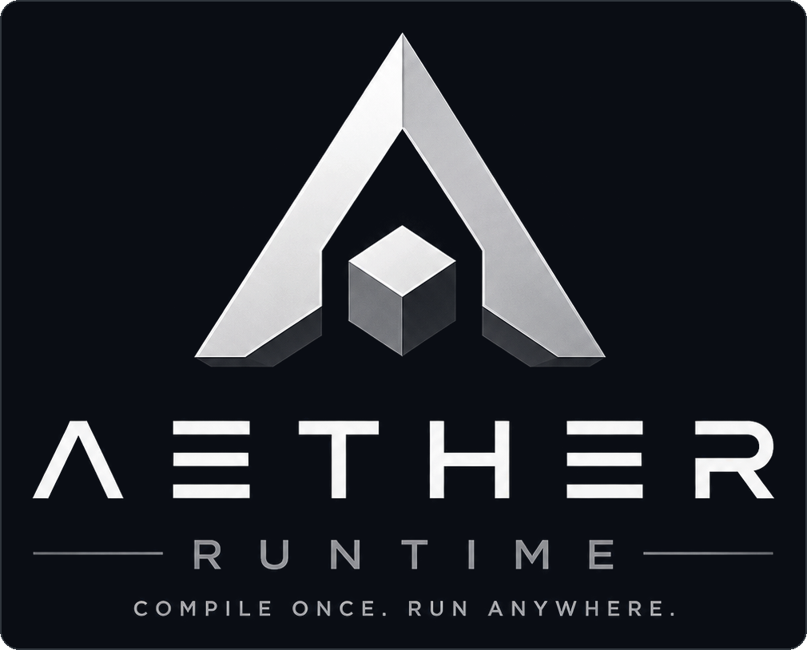
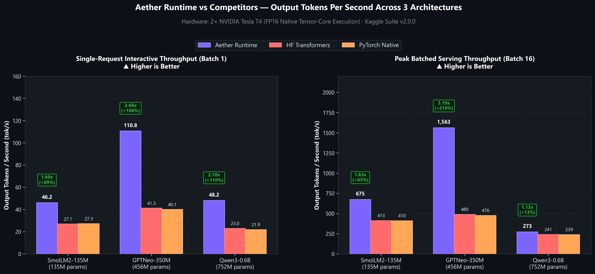
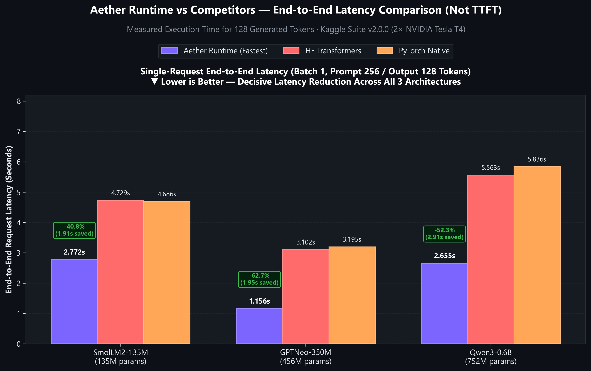

<p align="center">
  <a href="https://github.com/iamkaleemsajjad-hue/Aether">
    <picture>
      <source media="(prefers-color-scheme: dark)" srcset="logo/logo_dark.png">
      <source media="(prefers-color-scheme: light)" srcset="logo/logo_light.png">
      
    </picture>
  </a>
</p>

<h1 align="center">Aether Runtime</h1>

<p align="center">
  <strong>Compile supported models. Run portable AEG artifacts on compatible backends.</strong>
</p>

<p align="center">
  Aether is an open-source AI model compiler and high-performance inference runtime.<br>
  It ingests supported model graphs from HuggingFace, GGUF, SafeTensors, and ONNX and produces a portable<br>
  <strong>Aether Execution Graph (AEG)</strong> containing the graph, weights, and execution contracts.<br>
  CPU AEG execution is framework-free; accelerator execution requires a compatible installed backend.<br>
  Hardware profiles describe compilation targets, with executable, portable, and planning-only status recorded separately.
</p>

<p align="center">
  <a href="LICENSE"></a>
  <a href="pyproject.toml"></a>
  <a href="benchmark/results/BENCHMARK_RESULTS.md"></a>
  <a href="benchmark/results/BENCHMARK_RESULTS.md"></a>
  <a href="hardware_validation_matrix.json"></a>
</p>

<p align="center">
  <a href="#multi-engine-benchmark-results--aether-vs-competitor-engines">📊 <b>Benchmark Results</b></a> &bull;
  <a href="#quick-start">⚡ <b>Quick Start</b></a> &bull;
  <a href="#5-stage-compiler-pipeline">⚙️ <b>Architecture</b></a> &bull;
  <a href="#supported-hardware-targets">🖥️ <b>Hardware Targets</b></a> &bull;
  <a href="#installation">📦 <b>Installation</b></a> &bull;
  <a href="docs/">📚 <b>Documentation</b></a>
</p>

---

## Verified execution and current validation

Supported CPU models compile to an integrity-verified AEG, reload and generate
through the framework-free CPU engine. On an Intel Core i5-1334U running Windows,
the complete collection with Torch and Transformers installed passed **5,055 tests**
with 41 explicit skips in two serial processes on 2026-10-18. A before/after
replay preserved all 16 greedy tokens and produced zero logit difference. See the [environment, coverage and
limits](docs/mission-validation.md), [architecture](docs/mission-architecture-note.md)
and [current implementation status](IMPLEMENTATION_STATUS.md).

Hardware evidence uses three tiers: ✅ recorded physical execution with date and
scope; 🔬 reference/emulation/compile-time checks; 🛠 implemented and awaiting
hardware validation. Incomplete adapters remain explicit. The [generated target
table](#supported-hardware-targets) includes historical Intel UHD DirectML evidence.
Help us validate additional devices with `aether hardware validate TARGET --execute --json`.
Functional tests and recorded benchmarks have separate scopes; neither is a
production-readiness certification.

## Multi-Engine Benchmark Results — Aether vs Competitor Engines

For a MacBook with approximately 16 GB RAM, see the
[Aether vs ONNX Runtime / Qwen3-8B benchmark runbook](docs/benchmark-macbook.md).
It includes batch/token sweeps, reports and graphs, plus the current Aether CPU
memory and batching limits: the 8B native path cannot fit a 16 GB Mac.
The T4 results below describe a different run.

> **Hardware Testbed:** **2× NVIDIA Tesla T4 (14.6 GiB VRAM each)** · Intel Xeon @ 2.00 GHz · **FP16 Native Tensor-Core Execution** · Linux 6.12 · Kaggle Environment  
> **Software Stack:** Aether Runtime v1.3.0 vs HuggingFace Transformers v5.0.0 (PyTorch 2.10.0 eager) vs PyTorch Native Decode Loop  
> **Suite Version:** 2.0.0 (Strict per-engine process isolation, identical model commits, greedy evaluation, CUDA edge synchronization)  
> 
> 🔗 **Access Full Benchmark Results & Artifacts:**
> - 📊 **[Interactive Kaggle Notebook (with all cell executions & 31 charts)](benchmark/results/benchmark_results.ipynb)**
> - 📑 **[Comprehensive Markdown Benchmark Report (1,349 lines)](benchmark/results/BENCHMARK_RESULTS.md)**
> - 🚀 **[Kaggle Benchmark Runbook & Reproduction Guide](docs/benchmark-kaggle.md)**

---

### Executive Highlights — Aether Wins Across the Entire Field

| Performance Dimension | Aether Result | Competitor Comparison | Margin / Speedup | Evidence from Suite |
|---|---|---|---|---|
| **Overall Win Rate** | **100% (54 / 54)** | Transformers: 26% (14/54) · PyTorch Native: 0% (0/54) | **Undefeated across all 27 measured cells** | 0 losses, 0 ties across the full matrix |
| **Median Advantage** | **+94.2% vs HF** | PyTorch Native: **+104.3%** | **~2x faster median throughput across all models** | Pairwise anti-symmetric matrix |
| **Peak Throughput** | **1,562.72 tok/s** | Transformers: 489.17 tok/s · PyTorch Native: 476.01 tok/s | **3.19x faster (+219.5% margin)** | GPTNeo350M @ Batch 16 |
| **Batch 1 (Interactive)** | **Swept #1, #2, #3** | GPTNeo: **110.77 tok/s** · Qwen3: **48.21 tok/s** · SmolLM2: **46.18 tok/s** | **Up to 2.68x faster at Batch 1** | Aether took all top 3 spots in the field |
| **Time-to-First-Token (TTFT)** | **0.022s (22 ms)** | Transformers: 28 ms · PyTorch Native: 26 ms | **21% faster TTFT** (Prompt tok/s: **21,016.21**) | SummerSigh/GPTNeo350M-Instruct-SFT |
| **Single-Request Latency** | **1.156s** | Transformers: 3.102s · PyTorch Native: 3.195s | **62.7% lower latency (1.95s saved per request)** | GPTNeo350M Batch 1 (p256 / o128) |
| **Inter-Token Latency (TPOT)** | **9.00 ms** | Transformers: 24.22 ms · PyTorch Native: 24.96 ms | **2.7x faster per generated token** | Sub-10ms token generation loop |
| **Cold Start (Fresh Process)** | **Swept #1, #2, #3** | GPTNeo: **1.415s** · SmolLM2: **2.974s** · Qwen3: **2.999s** | **All <3.0s** (Competitors take 3.65s – 6.78s) | First unwarmed inference in fresh process |
| **Lowest Peak Host Memory** | **1.615 GiB** | PyTorch Native: 1.677 GiB · Transformers: 1.766 GiB | **Lowest host memory footprint** | SmolLM2-135M-Instruct |

---

### Overall Standings & Pairwise Head-to-Head

Every engine was scored identically by the same measurement harness across the exact same model revisions and prompt sequences:

| Rank | Engine | % of Best (Median) | W / L / T | Win Rate | Median Diff vs Field | Cells Measured | Pairings Evaluated |
|:---:|---|:---:|:---:|:---:|:---:|:---:|:---:|
| 🥇 | **`aether`** | **100%** | **54 / 0 / 0** | **100%** | **+99.2%** | 27 | 54 / 54 |
| 🥈 | `transformers` | 51% | 14 / 27 / 13 | 26% | -6.7% | 27 | 54 / 54 |
| 🥉 | `pytorch_native` | 49% | 0 / 40 / 14 | 0% | -8.7% | 27 | 54 / 54 |

#### Pairwise Matrix (Median % Advantage of Row Engine over Column Engine)

| Engine | vs `aether` | vs `pytorch_native` | vs `transformers` |
|---|:---:|:---:|:---:|
| **`aether`** | — | **+104.3%** | **+94.2%** |
| `pytorch_native` | -51.0% | — | -2.0% |
| `transformers` | -48.5% | +2.0% | — |

---

### Visual Benchmark Comparisons — 3 Engines across 3 Architectures

The charts below illustrate empirical measurements extracted directly from the comprehensive benchmark suite across all three architectures (`SmolLM2-135M`, `GPTNeo-350M`, `Qwen3-0.6B`) executed under strictly identical conditions on 2× NVIDIA Tesla T4 GPUs (FP16 Native Tensor-Core Execution).

#### 1. Output Tokens Per Second (Throughput) — 3 Engines across 3 Models



*Comparison of output tokens per second across all 3 evaluated models: **Single-Request Interactive Throughput** (Batch 1, prompt=256, output=128, left panel) and **Peak Batched Serving Throughput** (Batch 16, prompt=256, output=128, right panel). Aether delivers **1.71x to 2.68x** (+70.7% to +168.4%) higher single-stream throughput and scales up to **1,562.72 tok/s** at Batch 16.*

#### 2. End-to-End Single-Request Latency (Not TTFT) — 3 Engines across 3 Models



*Single-request end-to-end latency (seconds per request for 128 generated tokens; **▼ lower is better**). This measures full decode request completion time—distinct from Time-To-First-Token (TTFT)—where Aether decisively outperforms the field across all three architectures, cutting latency by **41.4% to 62.7%** and saving **1.95s to 2.91s per request** compared to HuggingFace Transformers and PyTorch Native.*

---

### Model-by-Model Results with Exact Empirical Evidence

#### 1. SummerSigh/GPTNeo350M-Instruct-SFT (456M Params)

> **Decisive Wins**: Peak throughput reached **1,562.72 tok/s** (+219.5% margin over Transformers). Single-user Batch 1 throughput reached **110.77 tok/s** (2.68x faster than Transformers at 41.27 tok/s) with a **62.7% reduction in end-to-end latency** (1.156s vs 3.102s). TTFT dropped to **22 ms** with prefill throughput exceeding **21,016 prompt tok/s**.

##### Throughput & Scaling Across Batch Sizes (Prompt: 256, Output: 128)

| Batch Size | Aether (tok/s) | Transformers (tok/s) | PyTorch Native (tok/s) | Aether vs HF Speedup | Aether vs PyTorch Speedup | Scaling Efficiency |
|:---:|:---:|:---:|:---:|:---:|:---:|:---:|
| **b1** | **110.77** | 41.27 | 40.06 | **2.68x (+168.4%)** | **2.77x (+176.5%)** | 100% |
| **b2** | **206.79** | 83.82 | 81.90 | **2.47x (+146.7%)** | **2.52x (+152.5%)** | 93% |
| **b4** | **447.40** | 165.86 | 161.17 | **2.70x (+169.7%)** | **2.78x (+177.6%)** | 101% |
| **b8** | **849.21** | 303.24 | 295.32 | **2.80x (+180.0%)** | **2.88x (+187.6%)** | 96% |
| **b16** | **1,562.72** | 489.17 | 476.01 | **3.19x (+219.5%)** | **3.28x (+228.3%)** | 88% |

##### Prompt & Output Length Sweeps at Batch 1

| Prompt Tokens | Output Tokens | Aether (tok/s) | Aether Latency | HF (tok/s) | HF Latency | PyTorch Native (tok/s) | Aether Margin |
|:---:|:---:|:---:|:---:|:---:|:---:|:---:|:---:|
| 32 | 128 | **112.92** | **1.134s** | 39.60 | 3.232s | 40.04 | **+185.1% (2.85x)** |
| 256 | 32 | **102.20** | **0.313s** | 40.88 | 0.783s | 39.22 | **+150.0% (2.50x)** |
| 256 | 128 | **110.77** | **1.156s** | 41.27 | 3.102s | 40.06 | **+168.4% (2.68x)** |
| 256 | 512 | **116.76** | **4.385s** | 41.05 | 12.473s | 40.42 | **+184.5% (2.84x)** |
| 1024 | 128 | **116.15** | **1.102s** | 39.78 | 3.218s | 39.19 | **+192.0% (2.92x)** |

---

#### 2. Qwen/Qwen3-0.6B (752M Params — RoPE + Per-Head Q/K Norm)

> **Decisive Wins**: Batch 1 throughput achieved **48.21 tok/s** (more than double Transformers' 23.01 tok/s, a **+109.5% margin**). Request latency dropped from 5.56s to **2.65s (52.3% lower)**. Inter-token latency improved from 43.42 ms down to **20.63 ms/token**. First-call cold start took only **2.99s** compared to Transformers' 6.14s.

##### Throughput & Scaling Across Batch Sizes (Prompt: 256, Output: 128)

| Batch Size | Aether (tok/s) | Transformers (tok/s) | PyTorch Native (tok/s) | Aether vs HF Speedup | Aether vs PyTorch Speedup |
|:---:|:---:|:---:|:---:|:---:|:---:|
| **b1** | **48.21** | 23.01 | 21.93 | **2.10x (+109.5%)** | **2.20x (+119.8%)** |
| **b2** | **82.63** | 44.86 | 43.39 | **1.84x (+84.2%)** | **1.90x (+90.4%)** |
| **b4** | **165.54** | 88.96 | 85.60 | **1.86x (+86.1%)** | **1.93x (+93.4%)** |
| **b8** | **234.55** | 171.74 | 165.88 | **1.37x (+36.6%)** | **1.41x (+41.4%)** |
| **b16** | **273.35** | 241.03 | 239.23 | **1.13x (+13.4%)** | **1.14x (+14.3%)** |

##### Prompt & Output Length Sweeps at Batch 1

| Prompt Tokens | Output Tokens | Aether (tok/s) | Aether Latency | HF (tok/s) | HF Latency | PyTorch Native (tok/s) | Aether Margin |
|:---:|:---:|:---:|:---:|:---:|:---:|:---:|:---:|
| 32 | 128 | **48.34** | **2.648s** | 22.53 | 5.681s | 21.89 | **+114.6% (2.15x)** |
| 256 | 32 | **44.30** | **0.722s** | 22.81 | 1.403s | 21.69 | **+94.2% (1.94x)** |
| 256 | 128 | **48.21** | **2.655s** | 23.01 | 5.563s | 21.93 | **+109.5% (2.10x)** |
| 256 | 512 | **50.37** | **10.164s** | 22.49 | 22.766s | 22.22 | **+124.0% (2.24x)** |
| 1024 | 128 | **46.10** | **2.777s** | 22.11 | 5.788s | 21.52 | **+108.5% (2.09x)** |

---

#### 3. HuggingFaceTB/SmolLM2-135M-Instruct (135M Params)

> **Decisive Wins**: Smooth scaling from **46.18 tok/s** at Batch 1 to **674.99 tok/s** at Batch 16 (+63.4% margin over Transformers). Interactive latency improved from 4.73s to **2.77s (41.4% faster)**. Peak host resident memory was only **1.615 GiB** (lowest of any engine). Prompt processing speed reached **8,905.61 prompt tok/s** (+44.2% faster prefill).

##### Throughput & Scaling Across Batch Sizes (Prompt: 256, Output: 128)

| Batch Size | Aether (tok/s) | Transformers (tok/s) | PyTorch Native (tok/s) | Aether vs HF Speedup | Aether vs PyTorch Speedup |
|:---:|:---:|:---:|:---:|:---:|:---:|
| **b1** | **46.18** | 27.06 | 27.32 | **1.71x (+70.6%)** | **1.69x (+69.1%)** |
| **b2** | **85.74** | 52.91 | 52.90 | **1.62x (+62.0%)** | **1.62x (+62.1%)** |
| **b4** | **178.19** | 105.85 | 105.23 | **1.68x (+68.3%)** | **1.69x (+69.3%)** |
| **b8** | **355.94** | 210.49 | 208.09 | **1.69x (+69.1%)** | **1.71x (+71.0%)** |
| **b16** | **674.99** | 413.00 | 410.20 | **1.63x (+63.4%)** | **1.65x (+64.6%)** |

##### Prompt & Output Length Sweeps at Batch 1

| Prompt Tokens | Output Tokens | Aether (tok/s) | Aether Latency | HF (tok/s) | HF Latency | PyTorch Native (tok/s) | Aether Margin |
|:---:|:---:|:---:|:---:|:---:|:---:|:---:|:---:|
| 32 | 128 | **44.93** | **2.849s** | 27.24 | 4.700s | 27.30 | **+65.0% (1.65x)** |
| 256 | 32 | **42.75** | **0.749s** | 27.16 | 1.178s | 26.62 | **+57.4% (1.57x)** |
| 256 | 128 | **46.18** | **2.772s** | 27.06 | 4.729s | 27.32 | **+70.6% (1.71x)** |
| 256 | 512 | **48.07** | **10.651s** | 27.05 | 18.927s | 27.45 | **+77.7% (1.78x)** |
| 1024 | 128 | **46.94** | **2.727s** | 26.59 | 4.814s | 27.00 | **+76.6% (1.77x)** |

---

### Interpreting the recorded benchmark

These results describe the recorded T4 workload and backend configuration.
Compilation prepares graph and weight layouts, but does not universally remove
Python or framework dispatch. Native C++ CPU kernels are optional; Torch paths
still execute through the installed framework. Cache layouts and operator fusion
depend on the selected execution engine.

For the recorded SmolLM2-135M request, a 7.0-second compilation and 1.96-second
generation-time difference imply amortization after about four identical
requests. This calculation does not establish a speedup for other prompts,
models, precision policies or hardware.

> 💡 **View the complete suite run, raw measurements, and all 31 charts in [`benchmark/results/benchmark_results.ipynb`](benchmark/results/benchmark_results.ipynb) and [`benchmark/results/BENCHMARK_RESULTS.md`](benchmark/results/BENCHMARK_RESULTS.md).**

---

## Core Principles

| Principle | Implementation |
|-----------|---------------|
| **Compile once, run anywhere** | Portable graphs and weights execute through declared compatible executable/portable contracts and installed adapters; `plan_only` is compilation metadata, not an execution engine |
| **PyTorch-free core** | The runtime, compiler, and CPU engine require only NumPy + tokenizers. PyTorch is optional (`pip install "aether-runtime[pytorch]"`) |
| **Hardware capability evidence** | Separates detected devices, available vendor runtimes, implemented backends, and physical execution validation |
| **Multi-GPU placement** | Plans compatible selected meshes using memory capacity and workload cost; physical multi-GPU execution needs a supporting backend and validation |
| **Framework-free native kernels** | C++ kernels compiled at runtime: INT4-GEMV, FlashAttention-2, fused RMSNorm+SwiGLU+Linear, GeGLU, RoPE, OpenMP parallel SGEMM |

---

## 5-Stage Compiler Pipeline

```
Model (HuggingFace / GGUF / SafeTensors / ONNX)
        │
        ▼
┌─────────────────────────────────────────────────────────────────┐
│ Stage 1: Ingestion & Architecture Detection                     │
│  • Reads config.json / GGUF header / SafeTensors metadata       │
│  • Detects registered architecture families and aliases       │
│  • Outputs: AEG-IR computation graph + ModelArchitecture        │
└─────────────────────────────────────────────────────────────────┘
        │
        ▼
┌─────────────────────────────────────────────────────────────────┐
│ Stage 2: Optimizer (22 Passes)                                  │
│  Pass 1: Operator Fusion (RMSNorm→QKV→RoPE, SwiGLU fusion)     │
│  Pass 2: Sensitivity scoring (method recorded)                │
│  Pass 3: Precision Assignment (mixed-precision per sensitivity) │
│  Pass 4: KV Cache Structuring (paged blocks, radix-tree hints)  │
│  Pass 5: MoE Expert Routing (hot/warm/cold tier classification) │
│  Pass 6: Parallelism Discovery (TP/PP/EP/CP strategy search)   │
│  Pass 7–22: Graph lowering, sparse attention, pruning, etc.     │
└─────────────────────────────────────────────────────────────────┘
        │
        ▼
┌─────────────────────────────────────────────────────────────────┐
│ Stage 3: Quantization                                           │
│  • Q4_K_M (explicit INT4 block-scaled format)                  │
│  • Q8_0 (INT8 symmetric)                                        │
│  • BF16 / FP16 / FP8 (E4M3 / E5M2)                            │
│  • MXFP4 / MXFP6 (microscaling, PRD v4.0+)                     │
└─────────────────────────────────────────────────────────────────┘
        │
        ▼
┌─────────────────────────────────────────────────────────────────┐
│ Stage 4: AEG Packaging                                          │
│  • Self-contained .aeg/ directory with manifest, weights,       │
│    tokenizer, precision map, sharding plans                     │
│  • Integrity-verified (SHA-256 per artifact)                    │
│  • Version-stamped (AEG/1.1 – AEG/3.0)                        │
└─────────────────────────────────────────────────────────────────┘
        │
        ▼
┌─────────────────────────────────────────────────────────────────┐
│ Stage 5: Target Code Generation                                 │
│  • CUDA (sm70–sm130), ROCm (RDNA3, CDNA3/4/5)                 │
│  • Apple Metal (M1–M5), OpenVINO (NPU/GPU)                     │
│  • Qualcomm QNN, RISC-V NPU, FPGA                              │
│  • Native CPU (AVX-512, AVX2, NEON, ternary BitNet)            │
└─────────────────────────────────────────────────────────────────┘
        │
        ▼
  AEG artifact (.aeg/) — executes through compatible declared contracts
```

Sensitivity reports identify weight reconstruction error or a labeled text
entropy proxy; the proxy is not measured model perplexity. Automatic precision
assignment currently uses BF16 storage, which can round higher-precision source
weights and still requires workload evaluation. Explicit formats are opt-in;
storage format does not establish the selected engine's arithmetic precision.

---

## Quick Start

```bash
pip install aether-runtime

# Compile a public model to a self-contained CPU AEG (also usable on GPU hosts)
aether compile HuggingFaceTB/SmolLM2-135M-Instruct --target cpu_avx2 --output smollm2.aeg

# Inspect the compiled artifact
aether inspect smollm2.aeg

# Run inference
aether run smollm2.aeg --prompt "Explain quantum entanglement." --max-tokens 128

# Benchmark performance
aether bench smollm2.aeg --max-tokens 128 --output results.json

# Optional API server
pip install "aether-runtime[server]"
aether serve smollm2.aeg --port 8080
```

Use `cpu_neon` on ARM. To request quantization explicitly, add
`--precision q4_k_m` or `--precision q8_0`; otherwise compilation preserves
automatic precision assignment. Explicit lossy precision requires your own
model-quality evaluation. For accelerator execution, install the backend your
artifact needs (portable CUDA/ROCm/MPS AEGs use `aether-runtime[pytorch]`) and
compile with the target reported by `aether hardware detect`.

Automatic dispatch uses a ready accelerator only when the model/artifact permits
that execution path, and otherwise uses compatible CPU execution. Hardware
inventory remains visible when optional GPU SDKs are missing. Detection,
dependency readiness, actual execution tests and production validation are
reported independently. See the [completion audit](docs/cli-hardware-completion-audit.md)
and [CLI validation matrix](docs/cli-command-validation.md) for measured results
and feature prerequisites.

### Python API

```python
from aether import Compiler, CompilerConfig, Runtime

# Compile — no PyTorch required
compiler = Compiler(CompilerConfig(targets=["cpu_avx2"]))
artifact = compiler.compile(
    "HuggingFaceTB/SmolLM2-135M-Instruct", output_path="smollm2.aeg"
)
print(artifact.root)

with Runtime() as runtime:
    response = runtime.generate(
        str(artifact.root), "Explain quantum entanglement.",
        max_tokens=128, apply_chat_template=True,
    )
    print(response.text)
    print(response.metrics.to_dict())

# Run compiled AEG
from aether.backends import GenerationRequest, get_backend

backend = get_backend("aether_cpu")
backend.load_model("smollm2", aeg_path=str(artifact.root))
try:
    result = backend.generate(GenerationRequest(
        model_id="smollm2",
        prompt="What is quantum entanglement?",
        max_tokens=128,
        extra={"apply_chat_template": True},
    ))
    print(result.text)
    print(result.metrics)
finally:
    backend.unload_model("smollm2")
```

---

## Multi-GPU Execution (Hardware-Aware Placement Planner)

When more than one device is present, Aether does not assume it should use them. It
**plans**: it measures the machine, reads the model's exact tensor geometry out of the
AEG, and judges every structurally admissible placement on two separate axes.

```bash
aether plan model.aeg --batch 4 --context 8192 --intent balanced
```

```
FEASIBILITY  binding device     1x cuda:0      TP=2/cap      PP=2/bal
  C_safe           GiB           12.96         12.96         12.96
  static S         GiB           15.51          7.88          7.88
  transient T      GiB            0.51          0.44          0.44
  margin z*sigma    GiB           0.17          0.15          0.15
  KV budget K      GiB           -3.23          4.49          4.49
  tokens_max                          0        74,724        74,724
  verdict                    INFEASIBLE      feasible      feasible

PERFORMANCE  decode/token     1x cuda:0      TP=2/cap      PP=2/bal
  bandwidth roof    ms           51.20         25.60         51.20
  dispatch roof     ms           27.16         59.75         27.16
  predicted TPOT    ms           51.20         61.16         51.22
  binding roof                bandwidth      dispatch     bandwidth
```

**Feasibility is a residual, not a comparison.** KV cache is the elastic term, so it is
what is *left over*:

```
C_safe(d) = min(free(d) - external(d), total(d)*kappa) - R_fixed(d)
K(d)      = C_safe(d) - static(d) - (transient(d) + z*sigma(d))
tokens_max = min_d floor(K(d) / kv_per_token(d))
```

That turns "does it fit" into a capacity, which is what lets Aether answer *"batch size
just changed"* without replanning and report the context ceiling at load time instead of
discovering it as an OOM. `kappa` is the only percentage in the model, and its job is to
absorb driver growth — not to test fit. `R_fixed` (CUDA context, cuBLAS workspace,
collective buffers) is **measured**, not modelled, and `sigma` is the standard deviation
of this device's own past prediction errors, so **the safety margin shrinks as evidence
accumulates.**

**Performance is three roofs, not two.** A Python-dispatched runtime has a ceiling the
roofline model does not contain, and for small-model decode it is the binding one:

```
t_stage = max( FLOPs/(theta_flops*u) , bytes/theta_bw , n_ops*t_dispatch )
```

Aether measures Qwen3-0.6B at 41.96 tok/s on one T4 — 23.8 ms/token. The two-roof model
predicts 3.75 ms and therefore *recommends sharding*. The model was never near its
bandwidth roof, and TP roughly doubles the host op count: predicted 53 ms, measured ~2×
slower. The third roof is what makes the planner get this right, and it also produces the
useful advice — *dispatch-bound at 23.8 ms against a 3.8 ms bandwidth roof; capture CUDA
graphs, don't add GPUs.*

**Two structural laws prune the search** before any ranking happens, which is why
planning takes under a millisecond for 8 devices instead of Gurobi-hours:

- **Homogeneity** — a TP group's devices must be within a *derived* throughput ratio of
  each other: `max(1 + sigma, heads*sigma - 1)`, the wider of the throughput-measurement
  noise floor and the ratio at which rounding a shard to a whole attention head breaks
  the planner's own error bar. A TP group is a barrier twice per layer, so the slowest
  member sets the pace on every layer. The bound *tightens as calibration accumulates*,
  and a measured crossover — recorded whenever a heterogeneous group misses its
  water-filled prediction — overrides the derivation outright. CPUs and mismatched GPUs
  never join one, by arithmetic rather than by name.
- **Fabric alignment** — a TP group may not cross a fabric class. Heterogeneity is
  expressed *across* pipeline stages, where each runs at its own pace.

Both laws are *structural*: they ask whether a group can be balanced, never whether
widening is worthwhile. That question belongs to the ranking lane, and keeping it there is
what stops the generator from deleting the only plan a too-large model has.

**Asymmetric splits are water-filling, and the objective is phase-dependent.** For a
16 GB + 24 GB pair holding a 21 GiB model, the capacity-optimal split is **33.8 / 66.2**
— which holds 74,724 KV tokens against 30,425 for a naive 50/50. Not 50/50, not
memory-proportional, not bandwidth-proportional: the constrained optimum.

| Sizing | Objective | Rule |
|--------|-----------|------|
| TP shard fractions | `min max t_i` | water-fill ∝ θ, capped |
| PP layers, throughput | `min max t_i` | water-fill ∝ θ, capped |
| **PP layers, latency** | **`min Σ t_i`** | **greedy — fastest device first** |

**A tie goes to fewer devices.** A wider plan is accepted only when its predicted gain
exceeds the planner's own error bar, which makes "use the minimum hardware necessary" a
consequence of the cost model rather than a preference. The same 34B model on two NVLink
A100s is selected as `TP=2` (1.97× faster, 4.6× the KV) under a graph-captured runtime and
`1× cuda:0` under an eager one — one formula, opposite answers, both correct.

Nothing is reactive: there is no OOM-and-retry path. An impossible workload is refused
before the load with the arithmetic and the fixes that would change the answer. Telemetry
feeds a calibration ledger keyed by device signature *and* backend build, so the next
prediction is tighter — never the current placement.

**The first run calibrates itself.** With no ledger entry there is no measured `sigma`, so
the planner runs one forward pass at the workload ceiling after the weights are resident,
reads peak allocated and `cuda_used - torch_reserved`, and folds both in — one profile run
for the *chosen* plan, not one per candidate. An allocation failure during that pass is
recorded as evidence the prediction was low rather than raised, because the pass exists to
protect the process. Set `AETHER_PLAN_BOOTSTRAP=0` to skip it; the record then says the
margin is uncalibrated instead of pretending otherwise.

**`t_dispatch` is verified, not trusted.** It belongs to the runtime build, so its ledger
key carries the interpreter, the framework and its CUDA build, Aether's own version and the
execution mode — and because no key can capture every change, a fresh probe reconciles
against the stored value on every census and replaces it when they diverge by 2×. The
record also prints the dispatch cost at which the verdict would flip (*"PP=2 would win
above 44.1 us/op"*), so a mis-keyed value cannot bias the answer silently even if it slips
past both defences.

Full design, including the fourteen stress-tested scenarios and what would falsify it:
[`docs/architecture-execution-planner.html`](docs/architecture-execution-planner.html).
Implementation: [`src/aether/placement/`](src/aether/placement/).

```python
from aether.placement import ExecutionPlanner, Intent, WorkloadEnvelope
from aether.placement.model_profile import profile_from_manifest

planner = ExecutionPlanner(profile_from_manifest(manifest))
decision = planner.plan(WorkloadEnvelope(
    batch_target=4, context_target=8192, generate_target=512, intent=Intent.BALANCED,
))
print(decision.render())                    # the full derivation
print(decision.selected.tokens_max)         # capacity, not a boolean
print(decision.plan.device_ids)             # which devices, and why
```

The compiler embeds sharding plans for 1–8 GPUs in every AEG artifact (Pass 6: Parallelism Discovery). At runtime the distributed engine reads the matching plan and reduces with Aether's own collectives.

**Which collective runs where — precisely.** "No NCCL" is true of two of the three paths, and the difference matters:

| Execution mode | Collective | NCCL / `torch.distributed`? |
|----------------|-----------|------------------------------|
| CPU, multi-process | `SocketCollective` — ring reduce-scatter + all-gather over TCP | **Not required.** Verified across real processes up to 8 ranks. |
| Single-process, multi-GPU | `aether.parallelism.p2p_ring` — one-shot / two-shot / ring over CUDA-ROCm peer-to-peer device copies | **Not required.** This is the path the tensor-parallel executor uses. |
| Multi-process or multi-node GPU | NCCL (CUDA) or RCCL (ROCm) via `torch.distributed` | **Required.** Aether does not reimplement inter-node GPU transport, and asking for this backend on a host without it fails closed. |

The peer-to-peer path picks its schedule per call from the α–β cost model, using the
detected link latency and bandwidth — because no single schedule is right at both
ends of the size range:

```
one-shot   α + (P−1)·D/B            volume (P−1)·D        — small payloads, latency-bound
two-shot   2α + 2(P−1)/P·D/B        volume 2(P−1)/P·D     — large payloads, fully peer-connected
ring       2(P−1)·α + 2(P−1)/P·D/B  volume 2(P−1)/P·D     — meshes without full peer access
```

Crossover, from setting the first two equal: `D* = α·P·B / ((P−1)(P−2))` for `P > 2`.
At `P = 2` one-shot is never worse — same volume, half the hops.

Every collective fails closed. A ring that loses a peer raises `CollectiveError`
rather than returning an approximation. Reductions run in a fixed device order, so
results are bit-reproducible and every device gets identical bytes.

```python
from aether.parallelism.p2p_ring import P2PRingCollective

collective = P2PRingCollective(["cuda:0", "cuda:1", "cuda:2", "cuda:3"])
reduced = collective.all_reduce(per_device_partials)   # every device: the full sum
root    = collective.reduce_to_root(per_device_partials)  # tree, ceil(log2 P) rounds
print(collective.stats()["requires_nccl"])            # False
```

References: Patarasuk & Yuan, *JPDC* 69(2), 2009 (ring bandwidth bound); Thakur,
Rabenseifner & Gropp, *IJHPCA* 19(1), 2005 (algorithm choice by message size);
Shoeybi et al., arXiv:1909.08053 §3.3 (why this all-reduce dominates TP cost).

---

## Hardware Detection

```python
from aether.runtime.hardware import HardwareDetector

print(HardwareDetector().detect().to_dict())
```

The target catalog includes the following profiles; detection reports queried device evidence, with execution readiness and validation stated separately: NVIDIA CUDA (sm70–sm130), AMD ROCm (RDNA3, CDNA3/4/5), Apple Metal (M1–M5), Intel OpenVINO (NPU/GPU), Qualcomm QNN, RISC-V NPUs (SiFive X160, XuanTie C930, MIPS S8200), Xilinx FPGA, and CPU (AVX-512, AVX2, NEON, ternary).

---

## Native CPU Kernel Stack

The Aether CPU engine can compile a cached C++ shared library when a supported
compiler is available. ISA and OpenMP availability determine the native build;
unsupported instructions are not enabled from a target label alone. The
following kernels also have reference paths. Performance depends on the model,
precision, toolchain and host:

| Kernel | Description | Research Basis |
|--------|-------------|----------------|
| `aether_int4_gemv` | Packed INT4 GEMV; smaller weight payload than INT8, with format overhead | GGML Q4_0 (2023), GPTQ (2022) |
| `aether_qgemv_affine` | INT8 affine-quantized GEMV | Frantar et al. 2022 |
| `aether_flash_attn` | FlashAttention-2 online softmax (O(seq·d) memory) | Dao, NeurIPS 2023 |
| `aether_rmsnorm_linear` | Fused RMSNorm + QKV projection (1 buffer) | ClusterFusion NeurIPS 2025 |
| `aether_rmsnorm_swiglu_linear` | Fused RMSNorm + full SwiGLU FFN (0 intermediate buffers) | Shazeer 2020, ClusterFusion 2025 |
| `aether_geglu` | GeGLU for Gemma/Gemma-2 FFN | Hendrycks 2016, Google Gemma 2024 |
| `aether_swiglu` | SwiGLU activation (Llama/Qwen/Mistral) | Shazeer 2020 |
| `aether_rope` | Rotary position embedding in-place | Su et al. 2021 |
| `aether_sgemv` | FP32 GEMV specialized for single-token decode | BLIS (Van Zee 2015) |
| `aether_sgemm` | Cache-blocked FP32 SGEMM (prefill) | BLIS tile layout |
| `aether_softmax` | Numerically stable row-wise softmax | Standard |
| `aether_rmsnorm` | Double-accumulation RMSNorm | Zhang & Sennrich 2019 |
| `aether_argmax` | Greedy token selection (OpenMP reduction) | Standard |

A compiler is optional for supported CPU AEG execution. Failed compilation is
reported visibly and the NumPy reference path remains available; neither path
establishes support for an otherwise unsupported model operator.

---

## Supported Model Families

Aether classifies **40 architecture families**, reached through **164** model-name
and Hugging Face architecture-class spellings. Support is graded, because "it
runs" and "its logits match the reference" are different claims:

| Level | Families | Meaning |
|-------|---------:|---------|
| ✅ Parity-verified | **26** | Every logit compared against the 🤗 Transformers reference (~1e-6) on the CPU, PyTorch, and tensor-parallel engines, for prefill and decode |
| 🟡 Runs, not gated | **6** | Compile → load → execute round-trip tested; no automatic per-logit comparison yet (5 encoders + T5/BART-class seq2seq) |
| 🔬 Known-incorrect | **4** | Executes, but measured output diverges from the reference — documented, not relied upon (Mamba, Mamba-2, RWKV-7, Jamba) |
| ❌ Refused | **4** | Detected and then rejected at compile time rather than producing a wrong artifact (DeepSeek MLA, MiniMax, VLM, Whisper) |

**36 families are executable; 26 are verified.** The exact numbers come from
[`src/aether/core/model_families.py`](src/aether/core/model_families.py) and are
asserted against this table by `tests/unit/test_model_family_registry.py`, so
they cannot drift. Print them yourself:

```bash
aether models              # the full graded matrix
aether models --counts     # just the numbers
```

A fine-tune of a verified family is covered by that family — detection keys on
structure, not on name — which is why Vicuna, Zephyr, Dolphin, Tulu,
Nous-Hermes, OpenChat, TinyLlama, Yi, InternLM, MiniCPM, SOLAR and the rest of
the Llama/Qwen/Mistral derivative space add detection keys rather than families.
See [SUPPORTED_MODELS.md](SUPPORTED_MODELS.md) for the per-family matrix with the
distinguishing numerics Aether derives from each checkpoint.

### The 26 parity-verified families

| Family | Models | Distinguishing contract |
|--------|--------|-------------------------|
| Llama 3.x | Llama-3.1-8B, 3.2-1B/3B, 3.3-70B | GQA + SwiGLU + RMSNorm + RoPE (baseline) |
| Qwen 2 / 2.5 | Qwen2-7B/72B, Qwen2.5, CodeQwen | GQA + SwiGLU, schedule-gated sliding window |
| Qwen 3 | Qwen3-0.6B → 72B | per-head Q/K-norm, decoupled `head_dim` |
| Qwen 3 MoE | Qwen3-MoE | experts **without** top-k renormalization |
| Mistral | Mistral-7B v0.1–v0.3, Ministral | GQA + SwiGLU |
| Mixtral | Mixtral-8x7B/8x22B | top-2 of 8 experts **with** renormalization |
| Gemma 2 | Gemma-2-2B/9B/27B | ×√H embeddings, (1+w) norms, sandwich norm, logit soft-caps, GeGLU |
| Gemma 3 (text) | Gemma-3-1B/4B/12B/27B | Gemma 2 + separate local rotary base |
| GPT-2 | GPT-2 117M–1.5B, DialoGPT | Conv1D layout, GELU-tanh, learned positions |
| GPT-Neo | GPT-Neo 125M/1.3B/2.7B | **unscaled attention**, local/global schedule |
| GPT-NeoX | GPT-NeoX-20B, Pythia 70M–12B | 25% partial rotary, head-interleaved QKV, parallel residual |
| GPT-J | GPT-J-6B | interleaved rotary, parallel residual |
| Phi-3 / Phi-4 | Phi-3-mini/small/medium, Phi-4 | fused QKV, LongRoPE factor tables |
| Falcon | Falcon-7B/40B | per-KV-group interleaved QKV, parallel residual |
| BLOOM | BLOOM 560M–176B, BLOOMZ | **ALiBi**, embedding LayerNorm |
| MPT | MPT-7B/30B | ALiBi, nested `attn_config` spellings |
| StarCoder2 | StarCoder2-3B/7B/15B | GQA, GELU-tanh, `layer_types` window |
| Cohere / Command-R | Command-R/R+/A, Aya Expanse | interleaved rotary, `logit_scale` |
| OLMo 2 | OLMo-2-7B/13B | **post-norm** block, full-projection Q/K-norm |
| OLMoE | OLMoE-1B-7B | full-projection Q/K-norm, unnormalized experts |
| StableLM | StableLM-2, StableLM-3B | 25% partial rotary |
| Granite | Granite-3.x, Granite Code | embedding/residual/attention/logit multipliers |
| EXAONE 4 | EXAONE-4-32B | post-norm, **NoPE global layers** |
| SmolLM 3 | SmolLM3-3B | interleaved NoPE layers |
| GLM-4 | GLM-4-9B/32B | interleaved + 50% partial rotary, GLM sandwich norm |
| Nemotron | Nemotron-4, Nemotron-Mini | `LayerNorm1P`, squared-ReLU FFN |

---

## Supported Hardware Targets

The registry includes executable, portable, and planning-only targets. A target
name does not establish that an executable vendor kernel is installed. Inspect
an AEG's `kernels.variant_status` and use `aether hardware detect` to check the
current host. See [runtime selection](docs/runtime.md) for the execution contract.

Detection reports hardware and runtime evidence; it does not certify execution.
Run `aether hardware validate cpu_generic --execute --json` for an offline CPU
AEG test, or replace the target with your detected GPU target and select its
installed backend. Execution and production validation are separate statuses.
See [hardware reporting and validation](docs/hardware-feedback-validation.md).

CUDA/ROCm/Metal AEG execution currently requires a matching PyTorch runtime.
An explicitly authorized dense-decoder AEG can also execute through semantic
ONNX export, including DirectML; generation, streaming and cached decode were
tested on an Intel Windows GPU. Vendor provider/operator support remains a
separate load-time check. Native CUDA, QNN/ANE, RISC-V NPU, FPGA and TensorRT-LLM
adapters retain incomplete integration and report unavailable.
See [runtime execution, precision and cache integration](docs/runtime-feature-integration.md)
for real phase workers, persistent sessions, explicit drafts and tested limits.

<!-- BEGIN GENERATED HARDWARE EVIDENCE -->
<!-- Generated by tools/render_hardware_readme.py; edit hardware_validation_matrix.json. -->
| Target | Hardware | Evidence tier | Technique and scope |
|---|---|---|---|
| `cpu` | Generic CPU | ✅ Recorded hardware execution | 2026-10-18: Physical i5-1334U, Windows AMD64; offline compile/save/reload/generate, cached decode and reference parity tests. Python 3.10.11, NumPy 1.26.4, Torch 2.9.1+cpu, Transformers 4.57.3, ORT 1.23.2; synthetic fixtures, no production claim |
| `directml` | Intel UHD Graphics through ONNX Runtime DirectML | ✅ Recorded hardware execution | 2026-10-14: Historical Intel UHD FP32 ONNX and supported dense AEG prefill/cached decode; DmlExecutionProvider attribution, CPU fallback disabled. ORT DirectML 1.24.4, driver 32.0.101.7085; not rerun in the current CPU environment |
| `cpu_avx512` | CPU AVX-512 | 🔬 Compile-time checks | Compilation recorded; execution pending |
| `amd_mi350x` | AMD MI350X | 🛠 Implemented; awaiting hardware validation | Help us validate with the matching runtime and device |
| `cuda_sm100` | NVIDIA Blackwell (B200) | 🛠 Implemented; awaiting hardware validation | Help us validate with the matching runtime and device |
| `cuda_sm100_gb300` | NVIDIA Blackwell Ultra (GB300) | 🛠 Implemented; awaiting hardware validation | Help us validate with the matching runtime and device |
| `cuda_sm120` | CUDA compute capability 12.0 planning profile | 🛠 Implemented; awaiting hardware validation | Help us validate with the matching runtime and device |
| `cuda_sm130` | CUDA compute capability 13.0 planning profile | 🛠 Implemented; awaiting hardware validation | Help us validate with the matching runtime and device |
| `cuda_sm70` | NVIDIA Volta (V100) | 🛠 Implemented; awaiting hardware validation | Help us validate with the matching runtime and device |
| `cuda_sm80` | NVIDIA Ampere (A100) | 🛠 Implemented; awaiting hardware validation | Help us validate with the matching runtime and device |
| `cuda_sm89` | NVIDIA Ada Lovelace (RTX 4090) | 🛠 Implemented; awaiting hardware validation | Help us validate with the matching runtime and device |
| `cuda_sm90` | NVIDIA Hopper (H100) | 🛠 Implemented; awaiting hardware validation | Help us validate with the matching runtime and device |
| `metal_m1` | Apple M1 | 🛠 Implemented; awaiting hardware validation | Help us validate with the matching runtime and device |
| `metal_m3` | Apple M3/M4 | 🛠 Implemented; awaiting hardware validation | Help us validate with the matching runtime and device |
| `rocm_cdna3` | AMD CDNA3 (MI300X) | 🛠 Implemented; awaiting hardware validation | Help us validate with the matching runtime and device |
| `rocm_cdna5_mi455x` | AMD CDNA5 (MI455X) | 🛠 Implemented; awaiting hardware validation | Help us validate with the matching runtime and device |
| `rocm_rdna3` | AMD RDNA3 (RX 7900 XTX) | 🛠 Implemented; awaiting hardware validation | Help us validate with the matching runtime and device |
| `cuda_sm100_tee` | NVIDIA Blackwell CC (Confidential Computing) | 🚧 Integration incomplete | Requires NVIDIA Confidential Computing hardware + CC attestation |
| `fpga_ternary` | Ternary BitNet FPGA | 🚧 Integration incomplete | Ternary FPGA backend not implemented |
| `fpga_xilinx_vu9p` | Xilinx Alveo U250 FPGA | 🚧 Integration incomplete | FPGA backend not implemented |
| `openvino_gpu` | Intel OpenVINO GPU | 🚧 Integration incomplete | OpenVINO package not installed; Aether task-specific inference adapter is incomplete |
| `openvino_npu` | Intel OpenVINO / NPU | 🚧 Integration incomplete | OpenVINO package not installed; Aether task-specific inference adapter is incomplete |
| `qualcomm_cloud_ai100` | Qualcomm Cloud AI 100 | 🚧 Integration incomplete | QNN backend not implemented beyond target profile |
| `qualcomm_qnn` | Qualcomm QNN NPU | 🚧 Integration incomplete | QNN backend not implemented beyond target profile |
| `riscv_cervell` | Cervell NPU RISC-V | 🚧 Integration incomplete | No Cervell hardware available |
| `riscv_mips_s8200` | MIPS/Wave S8200 | 🚧 Integration incomplete | No MIPS S8200 hardware available |
| `riscv_sifive_x160` | SiFive X160 RISC-V | 🚧 Integration incomplete | No SiFive X160 hardware available |
| `riscv_xuantie_c930` | XuanTie C930 RISC-V | 🚧 Integration incomplete | No XuanTie C930 hardware available |
| `tensorrt_llm` | NVIDIA TensorRT-LLM | 🚧 Integration incomplete | Engine loading and inference runner are incomplete; SDK presence is insufficient |
<!-- END GENERATED HARDWARE EVIDENCE -->

This evidence table comes from [the maintained catalog](hardware_validation_matrix.json).
Run `python tools/render_hardware_readme.py` after editing the catalog;
`python tools/render_hardware_readme.py --check` detects drift. Live hardware
detection is a separate snapshot. CPU ISA aliases and other planning profiles
are listed in [`src/aether/core/constants.py`](src/aether/core/constants.py).

---

## Phase 5 — Observability

Aether emits **OTLP directly** — the wire protocol, not a JSON file that resembles
it. `trace_id`/`span_id` widths, typed `AnyValue` attributes (`intValue` as a
string, per the protobuf JSON mapping), `timeUnixNano` events, per-span `kind`,
real gzip when `Content-Encoding: gzip` is advertised, W3C `traceparent`
propagation, trace-ID-ratio sampling, and the standard `OTEL_*` environment
variables. No dependency is needed for any of it; conformance is pinned by
[`tests/unit/test_otlp_conformance.py`](tests/unit/test_otlp_conformance.py).

```python
from aether.observability.otel import AetherTracer, OTLPExporter, MetricsCollector

tracer = AetherTracer(service_name="aether-prod", sample_rate=0.01)
exporter = OTLPExporter()          # honours OTEL_EXPORTER_OTLP_ENDPOINT/HEADERS/TIMEOUT
exporter.export_to_endpoint(tracer)

metrics = MetricsCollector()
exporter.export_metrics_to_endpoint(metrics)   # real explicit-bucket histograms
```

Joining a trace that started upstream, and a span that records its own failure:

```python
with tracer.span("aether.prefill", traceparent=request.headers.get("traceparent")) as span:
    span.add_event("kv_built", {"blocks": 128})
```

**Routing through an existing OpenTelemetry SDK pipeline** — span processors,
resource detectors, propagators, exporters configured by the host application —
is the one thing that needs the dependency:

```bash
pip install "aether-runtime[otel]"
```

```python
from aether.observability.otel_sdk import OpenTelemetryBridge, is_available

if is_available():
    OpenTelemetryBridge("aether-prod").emit_all(tracer.get_finished_spans())
    # spans keep Aether's trace_id, so they correlate rather than duplicating
```

```python
from aether.observability.ci_pipeline import CIEvalPipeline
from aether.observability.gates import DriftMonitor, ABRolloutController

pipeline = CIEvalPipeline(aeg_path='model.aeg', max_regression=0.02)
report = pipeline.run_and_save('eval_report.json', benchmarks=['hellaswag', 'mmlu', 'gsm8k'])

ctrl = ABRolloutController('exp-001', candidate_percent=0.01)
monitor = DriftMonitor(baseline_win_rate=0.80, alert_drop=0.05, min_samples=20)
```

**Prometheus metrics:** `aether_request_total`, `aether_ttft_ms{quantile=p50|p95|p99}`, `aether_tokens_per_second`, `aether_kv_hit_rate`, `aether_eagle_accept_rate`

---

## Content Credentials (C2PA)

`aether sign` writes a real [C2PA](https://c2pa.org) manifest store to
`provenance/c2pa.manifest` inside the package — not a hash chain with C2PA-shaped
field names:

* a **`c2pa.claim.v2` claim** in deterministic CBOR (RFC 8949 §4.2.1), referencing
  every assertion by hashed URI;
* an **assertion store** with the hard binding, `c2pa.actions.v2`,
  `c2pa.ingredient.v3` for the source checkpoint, and the compiler-pass chain;
* a **`COSE_Sign1` claim signature** (RFC 9052), detached, with the signer's X.509
  chain in the `x5chain` protected header;
* the tree serialized as **JUMBF** boxes (ISO/IEC 19566-5);
* a **`c2pa.hash.collection.data` hard binding** — one digest per file, so
  verification reports *which* file changed.

Ed25519 (RFC 8032), CBOR, COSE and JUMBF are implemented in pure Python, so signing
works on a stock CPython install; `cryptography` is used when present for speed and
for the ECDSA algorithms.

```bash
aether sign   ./model.aeg                      # generates a key on first use
aether verify ./model.aeg                      # exits non-zero if integrity fails
aether verify ./model.aeg --trust-anchor ca.pem
```

Verification reports five checks independently — manifest present, structure,
claim signature, assertion hashes, file binding — because the failures mean
different things. **Integrity is not identity:** a self-signed manifest proves the
artifact is unmodified and says nothing about who produced it, and `aether verify`
states that rather than printing "verified".

---

## Phase 6 — Ecosystem

```python
from aether.ecosystem.sdks import TypeScriptSDKGenerator, GoSDKGenerator, RustSDKGenerator

TypeScriptSDKGenerator().write('./sdk/typescript/')   # aether-sdk.ts
GoSDKGenerator().write('./sdk/go/')                   # aether_client.go
RustSDKGenerator().write('./sdk/rust/src/')           # aether_client.rs
```

---

## CLI Reference

| Command | Description |
|---------|-------------|
| `aether compile <model>` | Compile model to AEG package |
| `aether inspect <path.aeg>` | Show AEG package summary |
| `aether bench <path.aeg>` | Measure one greedy generation |
| `aether benchmark <path.aeg>` | Measure repeated generation runs |
| `aether serve <path.aeg>` | Start inference server |
| `aether eval <path.aeg>` | Run eval gate CI check |
| `aether hardware` | Show hardware profile |
| `aether models` | Show the graded model-family support matrix |
| `aether plan <path.aeg>` | Show the hardware-aware placement decision and its derivation |
| `aether hub push NAMESPACE/NAME path.aeg` | Upload to the configured Hub server |
| `aether hub pull NAMESPACE/NAME output.aeg` | Download from the configured Hub server |
| `aether sign <path.aeg>` | Sign with C2PA Content Credentials (CBOR claim + COSE_Sign1 + JUMBF) |
| `aether verify <path.aeg>` | Verify the claim signature, assertion hashes, and per-file binding |

Generate SDK clients through the Python APIs shown above. The
[complete CLI matrix](docs/cli-command-validation.md) records each command's
tested behavior and prerequisites.

---

## Installation

```bash
# Core runtime (no PyTorch, no CUDA required)
pip install aether-runtime

# With PyTorch for .pt/.pth model ingestion
pip install "aether-runtime[pytorch]"

# With HuggingFace Transformers for AutoTokenizer, AutoConfig
pip install "aether-runtime[transformers-frontend]"

# Development/test/server tools and PyTorch frontend
pip install "aether-runtime[full]"
```

---

## Testing

```bash
pip install -e ".[test]"
python -m pytest tests/ -v                                     # All tests
python -m pytest tests/unit/test_native_cpu_kernels.py -v     # CPU kernels
python -m pytest tests/unit/test_phase5_observability.py -v   # Observability
python -m pytest tests/unit/test_phase6_ecosystem.py -v       # Ecosystem SDKs
python -m pytest tests/unit/test_v31_elite_extensions.py -v   # v3.1 extensions
```

> **Run the suite serially.** `test_e2e_compile_run_cpu.py` and `test_v31_features.py` share the `~/.aether` cache; parallel pytest workers race on it.
>
> Tests requiring optional frameworks or live hardware skip when those dependencies
> are absent. Network tests are disabled unless `AETHER_RUN_NETWORK_TESTS=1` is set.

---

## Research Citations

| Feature | Research |
|---------|----------|
| INT4 GEMV | Gerganov GGML Q4_0 (2023), Frantar GPTQ (2022) |
| FlashAttention-2 | Dao et al., NeurIPS 2023 |
| Operator Fusion | ClusterFusion, NeurIPS 2025 |
| SwiGLU / GeGLU | Shazeer 2020 (GLU Variants); Hendrycks & Gimpel 2016 |
| BLIS SGEMM tiles | Van Zee & van de Geijn, TOMS 2015 |
| VRAM-weighted TP | Megatron-LM (Shoeybi et al. 2019); DeepSpeed (Rasley et al. 2020) |
| MoE Expert Routing | Zipf prior: Zoph et al. 2022; Fedus et al. 2022 |
| Sparse Attention | MInference (Microsoft, NeurIPS 2024) |
| KV Eviction | StreamingLLM (2023), ScissorHands (2024), SnapKV (2025) |
| Ring Attention | Ring Attention (2023), Striped Attention (2023) |
| YaRN RoPE | YaRN (2023), LongRoPE (2024) |
| Speculative Decoding | EAGLE-2 (2024), Medusa (2024) |
| CUDA Graphs | vLLM CUDA Graphs Dispatcher (2026) |
| Process Reward Model | Let's Verify Step by Step (2023), OmegaPRM (2025) |
| IP Fingerprinting | MetaFinger (2024), ADV-TRA (2025) |
| EU AI Act Compliance | Article 50 — AI content transparency obligations |
| Fleet Scheduling | Helium (2026), MuxWise SLO-aware scheduling (2026) |
| Disaggregated Serving | DistServe (2024), Mooncake (2024) |

---

## License

Apache 2.0

*Aether Runtime — portable model artifacts with explicit execution contracts.*
